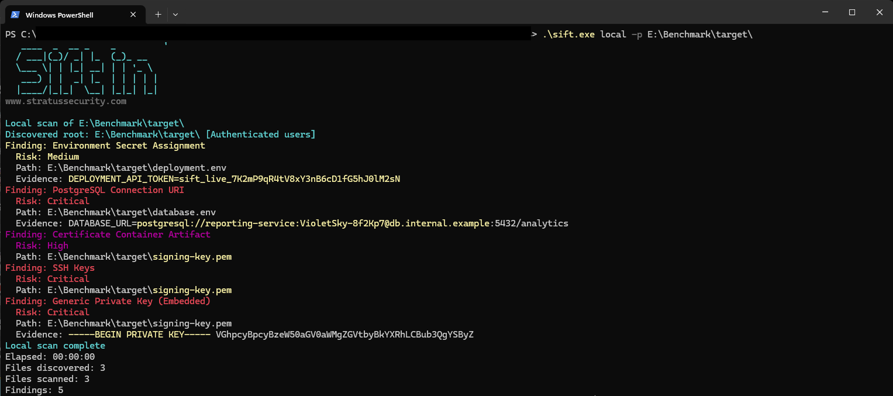

# Stratus Sift

<p align="center">
  
</p>

## What's this?
Sift is a tool developed by Stratus Security to improve our penetration testing, open-sourced to help improve data security for pentesters and security teams.
It searches data you can access for secrets and sensitive information across a number of platforms and it's *very* effective.

It's the [fastest and most effective](#benchmarks) tool for scanning shares, computers and cloud services (Including SharePoint, Teams, Slack, Jira and Confluence). See [here](#why-make-this-is-this-snaffler) for a big ol' list of why it's the best. e.g. Enable local LLMs to sift through false positives!

## TL;DR: How do I run this?
The quickest way, if you're familiar with Snaffler, is:
```
.\sift.exe local --path C:\
```

For more advanced commands, check out the [how to](#how-do) section below. It's worth a look.

Recent upgrades expand Microsoft 365 service coverage, Office and archive extraction, network target files, and reliable resume handling. See the [changelog](CHANGELOG.md) for the complete upgrade summary and validation limits. Normal scans do not require Ollama; local LLM filtering runs only when explicitly enabled.

## Why make this? Is this Snaffler?
Like most things we make, Sift is a tool developed out of frustration. For a while we used a custom fork of Snaffler like many in the industry, but ultimately it became harder to continue maintaining the fork than it was to just make it from scratch.

Sift was made with performance and extensibility in mind, to name a few great improvements over existing solutions:
- Self-contained Native AOT executables with no separate .NET runtime installation.
- Fewer false positives: Code-based validators refine matches, with optional local LLM filtering.
- Connector flexibility: Scan local files, network target lists and subnets, AD, Microsoft 365 storage and service workloads, Slack, Jira and Confluence. See [Microsoft 365 coverage](#additional-microsoft-365-workloads) for supported services and access requirements, or the [contribution docs](/CONTRIBUTING.md) to add a connector.
- Resumability: Every scan command can continue from durable checkpoints, so an interrupted scan only repeats a small amount of work.
- Deeper inspection: The tool checks both the head and tail of the document instead of just a smaller head.
- Performance: Local and SMB scans use a bounded high-throughput pipeline with compiled rules and reusable scan state. See [Benchmarks](#benchmarks) for the test method and measured results.
- Explicit authentication: Use the current identity, a password, Kerberos, or an NT hash for targeted SMB scans. Kerberos is preferred for domain accounts, with controlled NTLM fallback and a strict Kerberos mode.
- Safety features: Dodges unsynced OneDrive files instead of filling up a server's drives by accessing them all... hypothetically.
    - If you're worried about coverage, OneDrive is backed by SharePoint, so scanning SharePoint is better than scanning local drives :D
- File support: Enable `--binary` for PDF, Word, Excel, PowerPoint, OneNote and supported legacy Office documents, including embedded content. See [binary documents](#binary-documents) for formats, limits and OCR requirements.
- AI: We love some AI, but we also love privacy. And cake. The data gathered by Sift is extremely sensitive, so AI filtering uses only local LLMs to remove false positives.
- Cross-platform: The tool works on macOS, Windows and Linux (with varying feature support, of course!).
- Throttling: The pentesting CLI uses the available machine by default. Use `--threads` and `--max-read-mib-per-second` when scanning a sensitive production target.
- Detection quality: The bundled catalogue covers the Snaffler rules library, adds more detections, and refines noisy patterns. Code-defined validators support advanced checks and reduce false positives 📔
- DNS: Custom DNS servers for those times when you want to use computer names from a non-corp, wowee!
- ZIPin': Archives are enumerated and reported as `archive.zip!/path/file`. Terms and conditions may apply* (so we don't trigger a zip bomb)

## This is confusing, how do I just find the features I want?
The good ol' help flag will show the available commands:

```
> .\sift.exe --help

Usage:
  sift [command] [options]

Commands:
  local      Scan a local folder
  domain     Crawl the current Active Directory domain by auto-discovering accessible SMB shares.
  network    Crawl SMB targets on a subnet, a single device, or from a target file.
  m365       Scan Microsoft 365 storage and all supported service workloads using available access
  slack      Scan accessible Slack channel messages and attachments
  atlassian  Scan accessible Jira projects and Confluence pages, blog posts, comments, and attachments
  analyze    Replay saved JSON findings and optionally re-run LLM validation offline
```

and slap a command on to get help for that specific one:
```
> .\sift.exe domain --help

Usage:
  sift domain [options]

Options:
  -b, --binary                                  Include binary files in scan.
  -e, --enum-only                               Enumerate discovered drives, shares, or roots and exit without scanning file content.
  --llm-validate                                Validate classifier matches with a local Ollama model before reporting findings.
  --llm-sensitive-only                          Only keep findings that the LLM classifies as sensitive. Requires --llm-validate.
  --ollama-url <ollama-url>                     Base URL for the Ollama server. [default: http://localhost:11434]
  --ollama-model <ollama-model>                 Ollama model to use for classifier validation. If omitted with --llm-validate, an interactive prompt is used when possible.
  --llm-timeout-seconds <llm-timeout-seconds>   Timeout for each Ollama validation request in seconds. [default: 20]
  --llm-think <off|on|low|medium|high|xhigh>     Ollama thinking mode or level for validation. [default: off]
  --snaffler, --snaffler-mode                   Render console and CLI text output in Snaffler's logging style.
  -r, --rules <rules>                           Path to a folder containing sifting rules (JSON). If not provided, bundled defaults are used.
  -o, --output <output>                         Write scan output to a file. Resumed scans append; new scans replace it.
  -f, --output-format <output-format>           Output file format. Supported values: cli, json.
      --verbose                                 Include owner and last edit time in findings (CLI text and JSON).
  --resume                                      Continue from durable checkpoints saved by an earlier scan with the same target, credentials, rules, and scan settings.
  -u, --username <username>                     Windows username for SMB/LDAP impersonation. Accepts user, domain\user, or user@domain.
  -p, --password <password>                     Windows password for SMB/LDAP impersonation.
  -H, --nt-hash <nt-hash>                       32-character NT hash for explicit NTLMv2 SMB authentication. Targeted network scans only.
  --nt-hash-env <variable>                      Read the NT hash from an environment variable instead of a command-line value.
  -d, --domain <domain>                         Windows/AD domain for impersonation when --username is not already qualified.
  -l, --local                                   Use the local machine account namespace instead of a domain account.
  -k, --kerberos                                Require Kerberos for LDAP and SMB authentication and reject the default per-host NTLM fallback. Use DNS hostnames for service principals.
  --dns-server <dns-server>                     Send A, AAAA, PTR, and AD SRV queries directly to this DNS server IP address.
  -dc, --domain-controller <domain-controller>  Domain controller hostname or IP address to use for LDAP discovery if auto-discovery fails.
  -?, -h, --help                                Show help and usage information
```

## Benchmarks

To quantify performance, we ran comparable scans against synthetic file repositories. Snaffler was patched to report completion immediately instead of waiting for its once-per-minute check-in, keeping the comparison fair.

These three benchmark scenarios used the current Sift and Snaffler builds on 24 August 2026.

| Scenario | Sift | Snaffler |
| --- | ---: | ---: |
| 250,000 small files | 10.61 s | 25.48 s |
| 5.5 GiB content throughput | 0.69 s | 6.32 s |
| Deep and wide tree | 1.12 s | 2.37 s |

Each test was run three times. The aggregate averages are shown below:

| Metric | Snaffler 1.0.244 | Sift | Improvement |
| --- | ---: | ---: | ---: |
| Duration | 34.18 s | 12.42 s | 2.75x faster |
| Total CPU time | 276.56 s | 62.11 s | 4.45x less CPU time |
| Average CPU load | 25.3% | 15.6% | 1.62x lower load |
| Average memory | 337 MiB | 92 MiB | 3.68x lower memory |
| Memory-time | 11.24 GiB·s | 1.11 GiB·s | 10.1x less RAM-time |
| Peak memory | 429.5 MiB | 102.2 MiB | 4.20x lower peak |

Throughput is unlimited by default, as used above. Resource limits can be set explicitly when you need to reduce impact:

```powershell
.\sift.exe local --path C:\Shares --threads 8 --max-read-mib-per-second 32
```

## How Do?
In case you're wondering how to do the things, here are a few examples to get you started.

Scan a specific computer:
```powershell
.\sift.exe network --device SRV01 --output srv01-findings.log
```

Scan a mixed list of subnets and hosts:

```powershell
.\sift.exe network --targets-file targets.txt --output findings.log
```

Example `targets.txt`:

```text
# Office networks and file servers
10.20.30.0/24
10.20.40.25
SRV01
fileserver.example.test  # a hostname can have an inline comment
2001:db8::/120
```

Use one IPv4 address, IPv6 address, hostname, or CIDR per line. Blank lines, surrounding whitespace, optional quotes, and `#`, `;`, or `//` comments are accepted; inline comments must follow whitespace. UTF-8 and BOM-marked UTF-16 files are supported. Repeated hosts and overlapping ranges are deduplicated before discovery. IPv4 CIDRs omit network and broadcast addresses except for `/31` and `/32`; IPv6 CIDRs include every address. Hostname aliases that resolve to the same IP are not merged.

`--target-file` and `-t` are aliases for `--targets-file`. Choose one of `--targets-file`, `--subnet`, or `--device`. The existing authentication, DNS, enumeration, binary, and resume options also work with target files. Files are validated before any network discovery; invalid entries report their filename and line number. Target files accept hosts and CIDRs; use `--device` for UNC share roots. Files are limited to 8 MiB, 200,000 lines, and 65,536 expanded targets; oversized ranges fail before expansion. The same target expansion limit applies to `--subnet`.

Scan all shares in a domain from an unmanaged device:
```powershell
.\sift.exe domain --username pentester --password '<password>' --domain contoso.com --domain-controller 10.0.0.10
```

On Linux, use the domain DNS server to discover a controller and resolve hosts:
```bash
./sift domain --username pentester --password '<password>' --domain contoso.com --dns-server 10.0.0.10
```

Scan a subnet with a local admin:
```powershell
.\sift.exe network --subnet 10.0.0.0/24 --username Administrator --password '<password>' --local --output findings.log
```

Scan a host with an NT hash:
```powershell
.\sift.exe network --device 10.0.0.25 --username Administrator --nt-hash '<32-character-nt-hash>' --local --output findings.log
```

Keep the hash out of command history and process arguments:
```powershell
$env:SIFT_NT_HASH = Read-Host 'NT hash' -MaskInput
.\sift.exe network --device 10.0.0.25 --username Administrator --nt-hash-env SIFT_NT_HASH --local --output findings.log
Remove-Item Env:SIFT_NT_HASH
```

Pass-the-hash uses explicit NTLMv2 and works for `network --device` and `network --subnet` scans on every supported platform. The `domain` command discovers computers through LDAP, so it still requires a password, Kerberos ticket, or the current Windows identity.

On Linux, `network` supports explicit domain passwords, target-local passwords (`--local`), NT hashes, and a Kerberos ticket in a FILE credential cache. `domain` uses DNS SRV records to locate a controller and paged LDAP searches to find computers. With an explicit password, it normally binds over LDAPS on port 636; trust the controller certificate's issuing CA in the Linux trust store. With `--kerberos` or an existing ticket, it uses the system LDAP GSSAPI mechanism on port 389. Install the distribution's GSSAPI SASL module if that mechanism is missing (for example, `libsasl2-modules-gssapi-mit` on Debian-based systems). Set `KRB5CCNAME=FILE:/path/to/cache` for ticket-based SMB scans; the default FILE cache at `/tmp/krb5cc_<uid>` is also supported. Keep the scanner clock synchronized with the domain controllers for Kerberos.

For Linux domain scans, supply the AD DNS domain with `--domain` or a qualified `--username`, or use a ticket whose realm identifies the domain. `--dns-server` can resolve controller SRV records and target hostnames without changing the system resolver. The TLS certificate must match the controller's DNS hostname; a trusted CA is still required when connecting to an IP supplied by DNS.

Sift accepts the NT hash only. It does not accept LM hashes, `LM:NT` pairs, NetNTLM challenge responses, or Kerberos keys. Supplying the hash through `--nt-hash` may retain it in shell history or process listings; use `--nt-hash-env` when that matters.

Scan a local disk and then refine the results on another machine with a local LLM:
```powershell
.\sift.exe local --path C:\ --output findings.json --output-format json
.\sift.exe analyze --input findings.json --llm-validate --ollama-model gemma4:31b --sensitive-only --output findings.log
```

LLM validation disables thinking by default by explicitly sending `think: false` to Ollama. All scan commands and `analyze` accept `--llm-think off|on|low|medium|high|xhigh`: `off` sends `false`, `on` sends `true`, and named levels are passed to Ollama as strings. Named levels require support from the selected model. Changing the thinking setting starts a separate resume scope for scans using LLM validation.

Enable thinking when validating with Qwen:
```powershell
.\sift.exe analyze --input findings.json --llm-validate --ollama-model qwen3.8 --llm-think on --llm-timeout-seconds 120
```

Analyze results in a terminal without rescanning, translating to snafflers output style:
```powershell
.\sift.exe analyze --input findings.json --snaffler
```

Add `--verbose` to include owner and last edit in findings. CLI text shows the machine's local time and UTC offset; Snaffler-style timestamps also use local time. JSON uses `LastEditedAtLocal`; `analyze` can still read older results with `LastEditedAtUtc`. An unavailable last edit is shown as `Unknown` in CLI text and omitted from JSON.

Continue a previous or incomplete scan:
```powershell
.\sift.exe local --path C:\ --resume
.\sift.exe local --path C:\ --resume
```
Note: Use the same command and output path to continue the same scan; output is optional if you only need results in the terminal.

SMB scans continue through readable folders when another folder's listing fails. Failed files and subtrees remain pending, block unsafe directory checkpoints, and report a partial result with exit code `3`. Each folder is attempted once per crawl; `--resume` retries pending work and skips unchanged files using size and server creation/write/change timestamps. Files without usable timestamps are inspected again. Older SMB directory checkpoints restart enumeration because they may have omitted unreadable subtrees.

## Scan sources

Sift includes commands for:

- Local files and folders.
- Mounted filesystems, mapped drives, and Windows UNC shares.
- Host, subnet and line-delimited target-file SMB discovery, with Kerberos, password-based NTLM, and NTLMv2 pass-the-hash support.
- Active Directory discovery on Windows and Linux.
- Microsoft 365 storage and service content, including SharePoint, OneDrive, Teams, Planner, To Do, OneNote, targeted shared mailboxes, SharePoint Embedded, Viva Engage, Power BI and Dataverse-backed Power Platform sources. Available APIs and access determine coverage; personal email is excluded.
- Slack messages and attachments.
- Atlassian Cloud content in Jira and Confluence.

Microsoft 365 scans return exit code `3` when discovery or file processing is incomplete, including with `--enum-only`. Failed downloads and failed or truncated document extraction remain pending and prevent the drive checkpoint from advancing. Invalid configured library URLs also report incomplete discovery. REST scans follow library, file, and folder continuation pages; Graph scans recover once from an expired delta token by starting a fresh crawl, whose results determine whether the scan is complete.

Checkpoint writes wait for file processing and resume journal updates to succeed. Request throttling honors the full server `Retry-After` interval across workers, including Graph SDK retries. Large-file head scans enforce their byte limit even when the server ignores the range request. Office documents above the content size limit still report metadata findings without downloading their content; when content rules apply, the item remains pending. Excel extraction includes inline strings and rich text; SharePoint excludes only the library's system `Forms` folder, while scanning ordinary folders such as `Forms2026` and nested `Forms` folders.

Oversized ordinary remote text files deliberately use a head sample for efficiency: with the defaults, files above 10 MiB inspect the first 1 MiB. Successful completion means the configured sample was inspected; it does not imply full-file coverage.

Graph scans follow accessible same-tenant shortcuts using target drive/item identities. Folder targets follow every continuation page, with cycle detection, duplicate-target suppression, and limits of 128 traversal levels and 10,000 followed links. External or unclassified targets require `ScanExternalFiles`; known external targets are excluded before access when this option is disabled. Failed resolution or traversal keeps the drive incomplete. Drives with followed shortcuts use item-version resume records instead of source-drive delta checkpoints, so unchanged shortcuts cannot hide target edits; resumed runs re-enumerate these drives and skip unchanged content downloads.

SharePoint-native site search preserves results from completed pages when a later request fails, while reporting incomplete discovery. Search pagination uses Microsoft's [document-ID cursor guidance](https://learn.microsoft.com/en-us/sharepoint/dev/general-development/pagination-for-large-result-sets), avoiding the 50,000-row `StartRow` limit and rejecting invalid or non-advancing cursors.

Microsoft 365 ZIP scans inspect eligible entries even when no rule matches the outer `.zip` filename. Archives use complete content streams and the existing archive buffering, entry, expansion, and nesting limits, rather than the ordinary large-file head scan. Findings preserve `archive.zip!/entry/path`, including nested archive paths, and policy path filters are evaluated for each entry. Invalid archives, failed entry extraction, and content omitted by archive limits leave the remote item pending and report an incomplete scan.

Library discovery includes all file-backed libraries, including hidden/system libraries and empty libraries. Graph requests the `system` facet to include [otherwise hidden drives](https://learn.microsoft.com/en-us/graph/api/drive-list?view=graph-rest-1.0). SharePoint-native discovery uses [document-library base type `1`](https://learn.microsoft.com/en-us/sharepoint/dev/schema/listtemplate-element-list-template), which includes specialized and custom templates rather than only template `101`. Library titles and paths are not exclusion rules.

| Included libraries | Why they matter |
|---|---|
| Documents, custom document libraries, and organization assets | Files can be stored under any name or template. |
| Site Assets and picture/asset libraries | These are file libraries, including assets and files used by site content. |
| Pages, Site Pages, and wiki/publishing libraries | Page files and supporting files belong in the inventory. Reading modern page fields is separate from scanning the stored file. |
| Form Templates, workflows, and file-backed catalogs such as the master-page and web-part galleries | Templates, custom code, XML, and configuration can contain relevant content. |
| Hidden file-backed libraries, including PersonalCacheLibrary when exposed as a drive | Hidden status does not establish that a library has no relevant files. |
| Preservation Hold Library | [Retained copies](https://learn.microsoft.com/en-us/purview/retention-policies-sharepoint) can contain historical content. Discovery reports their inclusion; read-access failures remain incomplete. |

Generic lists such as contacts, taxonomy data, and MicroFeed are scanned through a separate site-content source. Their item fields and attachments do not depend on being exposed as document libraries. Microsoft recommends compliance tooling such as eDiscovery for access to retained content. This scanner attempts read access through its configured APIs; discovering a library does not establish that every file is readable.

### SharePoint and OneDrive coverage

Site scans include recursive subsites, generic list fields and attachments, custom document-library columns, modern page canvas and web-part text, previous file versions, and recycle-bin inventory. Structured fields and page bodies become separate `.json` scan items with decoded strings and visible HTML text; historical files keep their original filename and a version-specific finding link. Direct library targets remain limited to that library. Subsite traversal deduplicates site identities and stops at 64 levels or 100,000 sites. Collection readers reject repeated continuations, changed origins, and excessive page counts.

Unseeded delegated scans discover the signed-in user's OneDrive and supplement site/followed-site discovery with accessible-file search. App-only scans reconcile provisioned drives against the user directory; unprovisioned drives are skipped and denied directory/drive access reports incomplete discovery. Shared-file search is limited to the current search index and cannot guarantee an authoritative inventory of every sharing grant. Microsoft's [`sharedWithMe` endpoint](https://learn.microsoft.com/en-us/graph/api/drive-sharedwithme?view=graph-rest-1.0) is deprecated and stops returning data after November 2026; the scanner does not depend on it.

Sharing inspection records permission identities, roles, inheritance, author/creator identity, and `Public`, `External`, `Organization`, `Restricted`, or `Unknown` exposure. Directory users and transitive group members are checked for guest access; SharePoint groups use native membership APIs. Delegated Graph permission responses can be limited to grants visible to the caller, so restricted exposure requires native permission reconciliation. Unavailable permissions preserve content findings but leave items incomplete. Sharing and field/version sources are re-enumerated on resume, while content/version fingerprints avoid downloading unchanged files again.

Unavailable Graph directory principals do not stop native permission reconciliation when that reconciliation is required and available. Sharing remains unknown/incomplete if native access cannot resolve the assessment. Graph's current file version is scanned through the main file; supplemental history includes only earlier versions, avoiding the API's rejected current-version download. Native change feeds normalize CAML paths and finish rowset continuation pages before advancing change checkpoints.

The built-in SharePoint-native popup login can read SharePoint content and native permissions, but cannot request the Microsoft Graph directory permissions needed to inspect Entra group members. Sharing through those groups remains `Unknown` and incomplete with that login; signing in again does not expand its permissions. `ReadSharing=false` disables sharing inspection when validating content alone, so a successful run with that setting does not establish complete sharing coverage.

Expected access denials, disappeared files, and locked SMB files use debug diagnostics instead of per-item warnings. Incomplete work still produces a partial scan result and remains eligible for retry; skipped checkpoint boundaries do not generate repeated warnings. Unexpected item failures produce at most eight warning samples per drive plus a summary. The scanned counter includes completed content processing even when sharing inspection is unavailable, while the resume journal records only fully completed items. Native generic-list scanning excludes document libraries because their file-backed drives already scan those files and fields.

The SharePoint recycle-bin API supplies metadata, not a supported read-only download of original deleted content. Recycle-bin metadata can produce findings, but those items remain incomplete; the scanner never restores deleted files.

Coverage is enabled by default. Use `--config RecurseSubsites=false`, `DiscoverPersonalDrives=false`, `DiscoverSharedFiles=false`, `ScanListsAndPages=false`, `ScanLibraryFields=false`, `ScanVersions=false`, `ScanRecycleBin=false`, or `ReadSharing=false` to opt out of a source. `MaxVersionsPerFile` defaults to 1,000; reaching a limit reports incomplete coverage rather than committing the omitted content.

Graph access needs the applicable `Sites.Read.All`/`Files.Read.All` grants. User-drive reconciliation and guest classification additionally need `User.Read.All` and `GroupMember.Read.All`. List attachments, recycle-bin inventory, and native permission reconciliation need SharePoint-audience read permissions and sufficient permissions on the actual site/item. For app-only native SharePoint access, configure an Entra application certificate with `--config CertificatePath=C:\certs\scanner.pfx` and optional `CertificatePassword`; Graph client-secret authentication remains supported, but it does not establish native SharePoint access. These are separate audiences and consent grants.

Use `--config Cloud=Worldwide`, `GccHigh`, `DoD`, or `China` to select matching Graph endpoints and authority hosts. GCC uses `Worldwide`. Configure a client application registered in the selected cloud and its SharePoint tenant URLs; API availability and permissions in that cloud still govern which sources can be inspected.

Content, filename, and extension rules use the item's filename even when its browser URL contains a query string or opens an Office viewer. Browser URLs remain available for policy scope and findings. Discovery resolves library targets on the tenant's root site, rejects malformed search responses, and stops repeated Graph continuation links with an incomplete result. Resume lookups are synchronized with worker updates. SharePoint-native scans use [ResourcePath REST APIs](https://learn.microsoft.com/en-us/sharepoint/dev/solution-guidance/supporting-and-in-file-and-folder-with-the-resourcepath-api) and encode browser links to preserve literal `#` and `%` characters in library, folder, and file names.

Microsoft 365 resume records use server file versions to detect same-size edits. Files without a server version are scanned again. Older Microsoft 365 checkpoints are ignored after this reliability update, so the first `--resume` run starts a fresh scan.

### Additional Microsoft 365 workloads

The `m365` command attempts storage and every implemented service adapter by default, using the signed-in user's or application's existing access. No workload opt-in is required. Use `ExcludeWorkloads` through `--config` to omit services, or `Workloads=storage` for storage alone. `Workloads` can also restrict the scan to a comma-separated list from `teams,planner,todo,onenote,sharedmail,embedded,engage,powerbi,powerplatform`. Set `ScanStorage=false` for a workload-only run. File/site targets limit storage discovery; workload targets are configured separately.

| Workload | Content inspected | Scope limits |
| --- | --- | --- |
| teams | Accessible channel posts, every reply page, chats, referenced SharePoint/OneDrive files and hosted images | Delegated discovery starts from joined teams and the user's chats. Explicit team/chat IDs can select other accessible sources. App-only chat discovery reconciles the user directory. |
| planner | Basic plans, plan details, task titles, descriptions, checklists and file references | Graph's Planner API determines plan availability. Complete Planner Premium/Project coverage is not claimed. |
| todo | Accessible lists, task bodies, linked-resource metadata and file attachments | Personal and shared lists are included by default. IncludePersonalTasks=false restricts this adapter to shared lists; unknown sharing state then reports incomplete coverage. |
| onenote | Live page HTML, decoded visible text, embedded images and attachments | Delegated access only: Microsoft [retired app-only OneNote API authentication](https://learn.microsoft.com/en-us/graph/integrate-with-onenote) in March 2025. User/group scopes are discovered; additional sites use OneNoteSiteId. Stored notebook files remain a separate binary capability. |
| sharedmail | Subjects, full message bodies, nested/hidden folders, ordinary/inline file attachments and attached-item text | Explicit SharedMailbox targets only. The signed-in user's mailbox and aliases are excluded. App-only targets must report userPurpose=shared. Delegated targets must already be known shared mailboxes accessible to the caller. Unreadable nested/reference attachment payloads remain incomplete. |
| embedded | Container metadata and supported file types, including converted Loop/Fluid/Whiteboard content, in configured SharePoint Embedded containers | Requires EmbeddedContainerId or EmbeddedContainerTypeId and [container-type grants](https://learn.microsoft.com/en-us/sharepoint/dev/embedded/plan/authentication-permissions). The API requires container-type targeting for discovery; it does not provide an unrestricted tenant inventory. |
| engage | Accessible Viva Engage communities, posts/replies through unthreaded feeds and same-service downloadable attachments | Uses a separate API audience. Attachments needing another storage service retain metadata and report incomplete payload coverage. |
| powerbi | Workspaces, report/dashboard metadata and tiles, semantic-model parameters/data-source descriptions and dataflow definitions | Reads configuration/definitions; it does not query semantic-model rows or render/export reports. |
| powerplatform | Dataverse-accessible cloud-flow definitions, canvas app packages, model-driven app metadata and environment-variable definitions/values | Discovers Dataverse organizations or uses DataverseUrl. Environments/apps/flows outside Dataverse remain outside this adapter. It does not execute apps/flows or read every business table. |

Whiteboard and Loop files in discovered SharePoint, OneDrive and Embedded storage, and referenced drive files, use Microsoft's [HTML conversion API](https://learn.microsoft.com/en-us/graph/api/driveitem-get-content-format?view=graph-rest-1.0). Supported extensions are .whiteboard, .wbtx, .loop and .fluid. The scanner inspects the returned markup and decoded readable text while retaining the original name, extension, sharing metadata and source identity. Conversion is bounded, and it does not follow links from the converted HTML. This covers the service's text projection, not every canvas element or embedded image. Historical conversion is attempted where the service supports it; unavailable conversions retain metadata findings and remain pending. Native SharePoint scans also need Graph access for conversion. Microsoft's documented application permissions for conversion include write grants; the scanner does not request those grants.

Forms questions/responses still have no general inventory/content adapter here. Accessible Excel/JSON/document exports are inspected through storage.

Workloads re-enumerate collections and use item/content versions for resume. Failed or unavailable sources retain other findings and completed progress, but return exit code 3 for incomplete coverage. Expected access/consent failures do not produce individual warnings or stack traces; unavailable discovery sources appear in one grouped coverage note, with bounded source summaries and details at debug level. Folder cycles, repeated cursors, changed continuation origins/resources, excessive depth and item limits stop traversal. MaxWorkloadItems defaults to 1,000,000 per source; reaching the limit reports incomplete coverage.

Additional permissions require an explicit opt-in: --request-additional-permissions or --config RequestAdditionalPermissions=true. Without that setting, Graph uses .default silently after a minimal User.Read sign-in, and other audiences also use silent token acquisition. A missing grant leaves that source unavailable without opening another consent prompt. Normal sign-in and tenant authentication policies still apply. Explicit DelegatedScopes/Scopes stay authoritative, but additional consent still requires the opt-in. Users do not need Global Administrator to scan content they can already access through a suitably consented application.

When permission requests are enabled, the scanner requests read scopes for the selected services; tenant policy may require an administrator to approve some of them. Teams needs Chat.Read, ChannelMessage.Read.All, Team.ReadBasic.All and Channel.ReadBasic.All; discovery additionally needs relevant group/user read permissions. Teams/Planner file references use Files.Read.All and Sites.Read.All. Opaque sharing links can require additional existing grants; the scanner does not request write permissions to resolve them. Planner/To Do use delegated Tasks.Read or application Tasks.Read.All. OneNote uses delegated Notes.Read.All. Shared mail uses delegated Mail.Read.Shared and User.Read.All for directory identity/SMTP-alias lookup; app-only needs Mail.Read plus MailboxSettings.Read to verify mailbox type. Embedded needs FileStorageContainer.Selected plus container grants.

Viva Engage, Power BI and Dataverse use separate resource audiences with the configured credential and granted user/application access. Those adapters currently target the Worldwide cloud. The SharePoint-native popup cannot obtain the new Graph workload permissions; use a Graph-capable client ID and consented read scopes. Personal-email scanning is excluded.

For example, with a suitable Graph application:

~~~powershell
.\sift.exe m365 --interactive --tenant-id <tenant-id> --client-id <client-id> --binary --config Workloads=teams,planner,todo,onenote,sharedmail ScanStorage=false SharedMailbox=<shared-mailbox-address>
~~~

Optional targets are WorkloadUserId, WorkloadGroupId, WorkloadTeamId, WorkloadChatId, PlannerPlanId, OneNoteSiteId, EmbeddedContainerId, EmbeddedContainerTypeId and DataverseUrl. Repeat configuration keys or supply comma-separated values. SharedMailbox accepts a directory ID, user principal name, primary SMTP address or directory SMTP alias. An explicit target is required because Graph does not expose an authoritative list of the user's shared-mailbox delegations.

## Binary documents

Use `--binary` (`-b`) to enable text extraction in local, remote, and archive-entry scans. Binary documents retain filename and other metadata findings when this option is disabled.

| Formats | Extracted content |
|---|---|
| PDF and PNG/JPEG/TIFF/BMP/GIF/WebP images | Stored PDF text and bounded image OCR when the configured OCR runtime is available. |
| Word `.docx`, `.docm`, `.dotx`, `.dotm`, and Word 97–2003 `.doc`, `.dot` | Body, tables, text boxes, headers, footers, notes, comments, and stored field text. |
| Excel `.xlsx`, `.xlsm`, `.xltx`, `.xltm`, and Excel 97–2003 `.xls`, `.xlt` | Cell values, shared/inline/rich strings, stored formulas, and cell comments, including hidden worksheets. |
| Excel `.xlsb` | Cells in every worksheet, including hidden sheets, and XML comments. Formula cached values are read; uninspected formula expressions and binary comments leave the item incomplete. |
| PowerPoint `.pptx`, `.pptm`, `.potx`, `.potm`, `.ppsx`, `.ppsm`, and PowerPoint 97–2003 `.ppt`, `.pot`, `.pps` | Slide text, tables, speaker notes, comments, masters/layouts, and text in related chart/diagram parts, including hidden slides. |
| OneNote `.one`, `.onepkg` | Desktop and FSSHTTP section files and Cabinet notebook exports: current pages, conflict pages, nested outlines/tables, hyperlinks, stored image OCR/alt text, and stored ink recognition text. |

Extraction uses the existing Open XML SDK and [OfficeIMO's managed format readers](https://github.com/EvotecIT/OfficeIMO). It requires no Office installation and does not execute macros or open external links. `SourceAndConfig` includes every supported document extension. The `Documents` extension profile selects only these formats; bundled identity and financial content rules also use it. Explicit extension lists in custom rules remain authoritative.

Input documents default to 10 MiB and extracted text to 10 Mi characters. Configure `MaxDocumentMiB` (1–512) and `MaxExtractedCharacters` (1–67,108,864) using M365 `--config` values or `ContentScanner` application settings/environment variables. These limits are separate from ordinary remote text sampling. OneNote packages additionally cap expanded content at 64 MiB. Embedded Office/OneNote files and supported embedded archives share a depth limit (default 3), 1,000-part limit, and 512 MiB expansion budget. Encrypted, corrupt, truncated, unsupported, and over-limit content reports incomplete extraction. Available text findings are retained, and incomplete local/remote items are not checkpointed; CLI scans report exit code `3`. Updated resume fingerprints ensure newly covered content is inspected.

Expected binary extraction failures (including partial PDF OCR, malformed Office packages, unsupported embedded content and archive safety limits) use debug diagnostics instead of per-file warnings. Incomplete items still contribute to the partial scan result and remain pending for resume; unexpected scanner faults remain warnings. To inspect detailed reasons and available exception stacks, set `$env:Logging__LogLevel__Default = 'Debug'` in PowerShell before running the CLI. A parser reporting corruption can also mean an encrypted, truncated, mislabeled or unsupported document; it does not establish that the original file is damaged.

Embedded Office package and OLE attachments in Word, Excel, and PowerPoint are inspected when their payload format can be identified. Unsupported attachments preserve outer-document text findings and leave the item incomplete.

CLI binary scans enable OCR by default through a separately installed Tesseract runtime; use `TesseractPath`, `OcrLanguage` (default `eng`), `OcrTimeoutSeconds` (default 30, maximum 120), and `MaxOcrPages` (default 200) to configure it, or `EnableOcr=false` to disable it. Missing OCR tools or unreadable images report incomplete content instead of an empty successful scan. OCR is limited to two concurrent processes, bounded output, and document time limits; PDF image extraction does not rasterize vector-only text or reconstruct composite pages. These remain incomplete when no stored text can be read.

Supported Office and OneNote attachments are inspected without executing documents or following external relationships. CLI scans also inspect OneNote version-history/recycle content (`IncludeDocumentHistory=false` disables it). Audio/video, unsupported embedded objects, and pre-97 Word/PowerPoint remain incomplete when encountered. A standalone `.onetoc2` is a table of contents, not a section payload; section files must be enumerated separately.

Archive scans now include ZIP, 7z, RAR, TAR, gzip, bzip2, xz, lzip, zstd, and the corresponding common TAR wrappers. `EnableZipArchives` and the existing `MaxZip*` options control all supported archive families for API compatibility. Mixed nested formats share the same depth, entry, expansion, and buffering budgets. Entries are never extracted to archive-supplied filesystem paths, and links, encrypted content, malformed archives, or exhausted limits report incomplete inspection.

## Download

Download the binary for your system from the [latest release](https://github.com/Stratus-Security/Sift/releases/latest).

| System | x64 | Arm64 |
| --- | --- | --- |
| Windows | [EXE](https://github.com/Stratus-Security/Sift/releases/latest/download/sift.exe) | [EXE](https://github.com/Stratus-Security/Sift/releases/latest/download/sift-win-arm64.exe) |
| Linux | [Binary](https://github.com/Stratus-Security/Sift/releases/latest/download/sift-linux-x64) | [Binary](https://github.com/Stratus-Security/Sift/releases/latest/download/sift-linux-arm64) |
| macOS | [Binary](https://github.com/Stratus-Security/Sift/releases/latest/download/sift-osx-x64) | [Binary](https://github.com/Stratus-Security/Sift/releases/latest/download/sift-osx-arm64) |

Check downloaded files against [SHA256SUMS.txt](https://github.com/Stratus-Security/Sift/releases/latest/download/SHA256SUMS.txt). Release binaries are not code-signed yet.

Sift is licensed under [AGPL-3.0-only](LICENSE). Report security problems through [SECURITY.md](SECURITY.md) and read [CONTRIBUTING.md](CONTRIBUTING.md) before sending a change.

🪲 If there are any problems, please feel free to open an issue (or PR!) 🪲

## Sifting rules

Sift uses two kinds of JSON rules:

- A **sifting rule** describes what to find and how to report it.
- An **ignore rule** skips known noise before Sift opens or scans it.

The bundled catalogue lives under [`src/Stratus.Sift.Core/Defaults/Data`](src/Stratus.Sift.Core/Defaults/Data). It is usually easiest to copy a nearby example and change it.

Pass a rule directory to any scan command with `--rules`:

```powershell
.\sift.exe local --path C:\Review --rules .\my-rules
```

Sift reads every `.json` file below that directory. A file may contain one rule or an array of rules. File and folder names are only for organisation. Comments, trailing commas and case-insensitive property names are accepted.

The custom directory is the complete catalogue for that scan. It replaces the bundled rules rather than adding to them. Include every sifting rule and ignore rule that you want to use. If Sift cannot load any sifting rules, it uses the bundled sifting rules and retains any custom ignore rules.

### Example custom rule

Create `acme-token.json`:

```json
{
  "Name": "Acme API Token",
  "Description": "Finds Acme API tokens in source and configuration files.",
  "Severity": "High",
  "Matches": [
    {
      "Target": "Content",
      "Patterns": [
        "\\bacme_[A-Za-z0-9]{32}\\b"
      ],
      "Keywords": [
        "acme_"
      ],
      "ExtensionProfile": "SourceAndConfig"
    }
  ],
  "EnableLlmValidation": false,
  "ExcludePaths": [ "**/test-fixtures/**" ]
}
```

A sifting rule requires only `Name` and `Matches`. Every other top-level field is optional. Every enabled rule reports its matches. Patterns within a rule are alternatives, so any matching pattern can produce a match.

| Field | Required | Purpose |
| --- | --- | --- |
| `Name` | Yes | Stable rule and finding name. |
| `Matches` | Yes | One or more metadata or content match blocks. |
| `FindingName` | No | Different name for the reported finding. The default is `Name`. |
| `Description` | No | Short explanation of what the rule detects. |
| `Severity` | No | `Info`, `Informational`, `Low`, `Medium`, `High`, or `Critical`. The default is `Medium`. |
| `Enabled` | No | Enables the rule. The default is `true`. |
| `Validator` | No | Built-in validation step used after a pattern matches. |
| `EntropyThreshold` | No | Minimum Shannon entropy for the matched value. `0`, the default, disables this check. |
| `EnableLlmValidation` | No | Allows the match to be checked when the scan uses `--llm-validate`. The default is `true`, but no LLM is called unless that command option is supplied. |
| `MinMatchCount` | No | Number of matches required on one item before a finding is kept. The default is `1`. |
| `IncludePaths` | No | Allowlist of full-path wildcard expressions. |
| `ExcludePaths` | No | Blocklist of full-path wildcard expressions. |
| `StopOnMatch` | No | Stops the current matching pass after this rule reports a match. The default is `false`. |
| `ReportFinding` | No | Set to `false` for a parent rule that only gates its `SubRules`. The default is `true`. |
| `SubRules` | No | Second-stage rules evaluated after their parent matches. |

Each item in `Matches` supports:

| Field | Required | Purpose |
| --- | --- | --- |
| `Patterns` | Yes | One or more literal values or .NET regular expressions. |
| `Target` | No | The part of the item to inspect. The default is `Content`. See the table below. |
| `IsLiteral` | No | Treats patterns as plain text. The default is `false`, which uses regex for content patterns. |
| `CaseSensitive` | No | Makes patterns and keywords case-sensitive. The default is `false`. |
| `Keywords` | No | Fast prefilter for content rules. At least one keyword must be present before the regex runs. The regex must still match. |
| `ExtensionProfile` | For content¹ | Named extension allowlist. `SourceAndConfig` is currently provided. |
| `IncludedExtensions` | For content¹ | Additional extensions such as `.txt`, `.config`, or `.ps1`. |

¹ A top-level content match must declare `ExtensionProfile`, `IncludedExtensions`, or both. A content `SubRule` inherits the scope established by its parent.

The available targets are:

| Target | What it checks |
| --- | --- |
| `Content` | File, message, page, issue, or attachment text. Patterns are regex unless `IsLiteral` is true. |
| `FileName` | The leaf filename, such as `id_rsa` or `secrets.json`. |
| `FileExtension` | The file extension, such as `.env` or `.pem`. |
| `DirectoryName` | An individual directory name, such as `.git`. |
| `DirectoryPath` | The full path. Plain values match the beginning of the path; regex patterns can express more complex scopes. |
| `ShareName` | The share component of a UNC path, such as `Finance` in `\\server\Finance`. |

Content rules must declare `ExtensionProfile`, `IncludedExtensions`, or both. The two lists are combined. This keeps broad content expressions away from file types where they are unlikely to be useful.

`Keywords` are an optimisation, not extra evidence. Choose a short literal that every valid match is expected to contain. Leave the list empty when no safe keyword exists. A poor keyword can prevent valid matches from being tested.

Content regexes have a one-second match timeout. Sift uses the .NET non-backtracking engine where the expression supports it. Keep expressions bounded and avoid broad forms such as `.*` across large regions. The entire regex match becomes the reported value; a capture group does not change which text is used as evidence.

`Validator` can add checks that are awkward to express safely in regex, such as a checksum or token structure. JSON rules can use the built-in names in the [`ClassifierValidatorCatalog`](src/Stratus.Sift.Core/Validation/ClassifierValidatorCatalog.cs). Adding a validator requires a code change. JSON files cannot load executable code.

Path scopes and ignore rules use filesystem wildcards such as `*`, `?`, and character classes, not regular expressions. Exclusions are checked after inclusions.

### Two-stage rules

Use a parent rule when a cheap metadata check should gate a more specific content check. Set `ReportFinding` to `false` on the parent, then place the reporting rules in `SubRules`:

```json
{
  "Name": "Acme credential file",
  "ReportFinding": false,
  "Matches": [
    {
      "Target": "FileName",
      "IsLiteral": true,
      "Patterns": [ "acme.json" ]
    }
  ],
  "SubRules": [
    {
      "Name": "Acme credential",
      "Severity": "Critical",
      "Matches": [
        {
          "Target": "Content",
          "Patterns": [ "\\\"token\\\"\\s*:\\s*\\\"([^\\\"]+)\\\"" ],
          "IncludedExtensions": [ ".json" ]
        }
      ]
    }
  ]
}
```

See [`Firefox Login Store.json`](src/Stratus.Sift.Core/Defaults/Data/Rules/Files/Firefox%20Login%20Store.json) for a bundled example.

### Ignore rules

Ignore rules remove known noise early. They use simple filesystem wildcards rather than regex.

```json
[
  {
    "Pattern": "node_modules",
    "MatchTarget": "DirectoryName",
    "Description": "Third-party Node dependencies",
    "IsEnabled": true
  },
  {
    "Pattern": "*.min.js",
    "MatchTarget": "FileName",
    "Description": "Generated minified JavaScript",
    "IsEnabled": true
  }
]
```

`MatchTarget` accepts the same target names as sifting rules. `Content` on an ignore rule is treated as a path match because ignore rules run before content is read. Directory, path, and share ignores can prune an entire branch, so test broad patterns carefully.

| Field | Required | Purpose |
| --- | --- | --- |
| `Pattern` | Yes | Filesystem wildcard to ignore. |
| `MatchTarget` | No | Part of the path to check. The default is `FileName`. |
| `Description` | No | Reason for the ignore rule. |
| `IsEnabled` | No | Enables the ignore rule. The default is `true`. |

### Testing a rule

Make a small fixture directory containing:

- One file that should match.
- Similar values that should not match.
- Examples in allowed and disallowed extensions.
- Uppercase and lowercase variants if case matters.
- A path covered by each include, exclude, or ignore rule.

Run only that fixture while developing:

```powershell
.\sift.exe local --path .\rule-fixtures --rules .\my-rules --output .\rule-test.log
```
